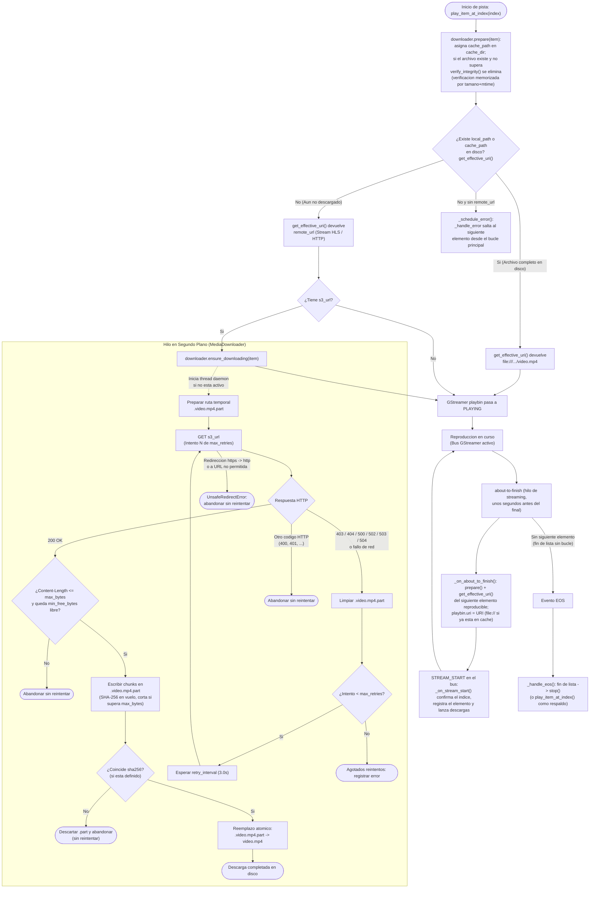
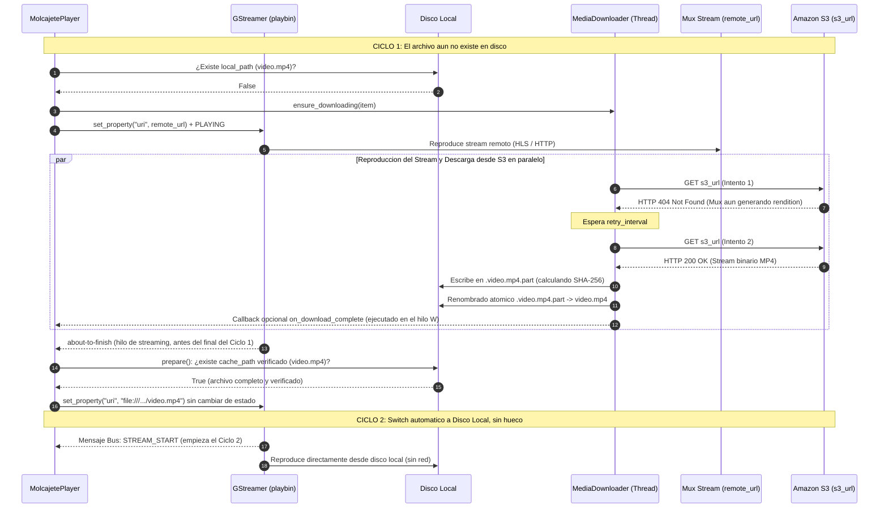

# Flujo Multimedia: Stream Remoto, Descarga S3 y Conmutacion a Disco Local

Este documento describe en detalle la arquitectura de doble via de **Molcajete Player** para reproducir contenido audiovisual de forma inmediata mediante *streaming* mientras se descarga en segundo plano el archivo definitivo (*rendition* MP4) desde Amazon S3 hacia el disco local.

---

## 1. Contexto y Problema que Resuelve

Cuando un usuario sube un video a una plataforma de video en la nube (como **Mux**):
1. **Disponibilidad rapida para streaming**: El servicio publica casi de inmediato un flujo adaptativo HLS (`remote_url`, archivo `.m3u8`) listo para reproducirse por red.
2. **Generacion asincrona del archivo MP4 (*rendition*)**: La transcodificacion del archivo MP4 estatico y su transferencia al bucket de **Amazon S3** (`s3_url`) toma mas tiempo. Durante esos primeros segundos o minutos, consultar la URL de S3 devuelve errores transitorios (`HTTP 404 Not Found` o `HTTP 403 Forbidden`).
3. **Objetivo en dispositivos de reproduccion**: El reproductor no debe bloquear la pantalla esperando a que exista el MP4 en S3 ni depender permanentemente del ancho de banda de red una vez que el archivo puede almacenarse localmente.

**Molcajete Player** resuelve esto desacoplando la reproduccion inmediata (`remote_url`) de la adquisicion del archivo persistente (`s3_url` $\rightarrow$ `local_path`), realizando la conmutacion (*switch*) hacia el disco local la siguiente vez que el elemento se precarga tras completarse la descarga. Los cambios entre videos son sin huecos y el reproductor nunca emite audio.

---

## 2. Diagrama de Flujo (Flowgraph)

El siguiente diagrama muestra el flujo de decision en `MolcajetePlayer` (`player.py`) y el trabajo concurrente del hilo de descarga en `MediaDownloader` (`downloader.py`):



---

## 3. Diagrama de Secuencia Temporal (Ciclo 1 vs. Ciclo 2)

En una lista en bucle (`loop: true`), la transicion entre el stream de Mux y el archivo descargado de S3 ocurre sin interrumpir la reproduccion en curso:



---

## 4. Componentes y Detalles de Implementacion

### 4.1 Modelo de Datos (`MediaItem` en `src/molcajete_player/models.py`)
Cada elemento de la lista admite los siguientes campos para la resolucion y verificacion del medio:
- `remote_url`: URL de *streaming* inmediato (p. ej. `https://stream.mux.com/<PLAYBACK_ID>.m3u8`).
- `s3_url` (tambien aceptado como `download_url` en el JSON): URL HTTPS del objeto MP4 en S3 (compatible con **S3 Presigned URLs** temporales).
- `sha256` (tambien aceptado como `checksum`): Resumen criptografico SHA-256 hexadecimal de 64 caracteres para verificar la integridad del archivo descargado.
- `local_path`: Ruta a un archivo preinstalado (rechaza `..`; con `--media-root` debe quedar dentro de ese directorio, resolviendo enlaces simbolicos). Si existe, evita la descarga desde `s3_url`.
- `cache_path` (interno, no se lee ni se escribe en el JSON): ruta determinista confinada en `cache_dir` (`<id_sanitizado>_<hash16>.mp4`) que asigna `MediaDownloader` a los elementos con `s3_url`.

Antes de resolver la URI, `MolcajetePlayer.play_item_at_index()` llama a `MediaDownloader.prepare()`, que asigna `cache_path` y, si el archivo de cache existe pero no supera `verify_integrity()`, lo elimina. Despues, `MediaItem.get_effective_uri()` aplica la siguiente prioridad estricta (sin volver a verificar el hash):
1. Si `local_path` existe en disco, devuelve su URI `file://`.
2. Si `cache_path` existe en disco, devuelve su URI `file://`.
3. Si `remote_url` esta definido, devuelve `remote_url`.
4. Si no hay `remote_url` pero se definio `local_path`, devuelve la URI `file://` de `local_path`.
5. Si no hay ninguna fuente, lanza `ValueError`; el reproductor programa el fallo con `GLib.idle_add` y `_handle_error` salta al siguiente elemento (la lista no se detiene, salvo que fallen todos los elementos consecutivamente).

### 4.2 Descarga Atomica, Aislada y Verificada (`MediaDownloader` en `src/molcajete_player/downloader.py`)
Para proteger maquinas tipo kiosko *on-site* y evitar que GStreamer intente reproducir archivos incompletos o manipulados:
- **Directorio de cache aislado (`cache_dir`) y nombres deterministas**: Ninguna descarga confia en rutas arbitrarias del JSON. Todos los archivos descargados se guardan en `cache_dir` (`~/.cache/molcajete-player/media`, `MOLCAJETE_CACHE_DIR` o `--cache-dir`) bajo `<id_sanitizado>_<hash16>.mp4`, ignorando los *query strings* cambiantes de las S3 Presigned URLs y ocultandolos en los logs (`?<redacted>`).
- **Exigencia de HTTPS**: Se rechazan descargas remotas por HTTP plano en modo kiosko (permitiendo loopback local `127.0.0.1`/`localhost` unicamente para pruebas locales). Cada redireccion se valida con las mismas reglas y se rechaza cualquier paso de `https://` a `http://` (incluido loopback), cancelando la descarga sin reintentar.
- **Limites de disco**: la descarga se cancela si `Content-Length` o los bytes recibidos superan `max_bytes` (8 GiB por defecto) o si tras la descarga quedarian menos de `min_free_bytes` (256 MiB) libres en el disco de la cache.
- **Mantenimiento de la cache**: `prune_cache(items)` (invocado por `MolcajetePlayer.run()` salvo `--no-prune-cache`) elimina los renditions que no pertenecen a la lista actual y los `.part` huerfanos; `clear_cache()` (`--clean-cache`) elimina todos. Ambos solo tocan archivos con el patron de nombres del reproductor.
- **Archivo temporal oculto `.part` y verificacion SHA-256 en vuelo**: Todos los bytes recibidos desde `s3_url` se escriben inicialmente en `.<nombre_archivo>.part` mientras se calcula su hash SHA-256 en memoria. Si `item.sha256` esta definido y no coincide con el contenido recibido, el archivo `.part` se elimina de inmediato sin llegar a activarse.
- **Reemplazo atomico**: Solo cuando la transferencia HTTP finaliza por completo y supera la verificacion SHA-256, se ejecuta `part_path.replace(target_path)`. En sistemas POSIX (Linux/macOS), `replace` dentro del mismo directorio es una operacion atomica en el sistema de archivos.
- **Tolerancia a estados de S3/Mux**:
  - Los codigos HTTP `403`, `404`, `500`, `502`, `503` y `504` (asi como errores temporales de socket/red) eliminan cualquier `.part` parcial y programan un nuevo intento tras `retry_interval` segundos (por defecto `3.0s`, hasta `max_retries = 60` intentos).
  - Otros errores HTTP definitivos (por ejemplo `400 Bad Request` o `401 Unauthorized`) cancelan la descarga inmediatamente sin reintentar.
- **Fallo de integridad definitivo**: si el SHA-256 calculado no coincide, el `.part` se elimina y el hilo termina sin reintentar. La descarga se volvera a intentar la proxima vez que el elemento se reproduzca.
- **Callback de finalizacion**: `MediaDownloader.on_download_complete(item, path)` se ejecuta en el hilo de descarga. El parametro `on_download_complete` de `MolcajetePlayer` recibe el mismo evento reenviado al bucle principal con `GLib.idle_add`, por lo que puede interactuar con GStreamer o Gtk.
- **Parada y reanudacion**: `MediaDownloader.stop(join_timeout=0)` impide iniciar descargas nuevas y corta las activas en el siguiente bloque; `resume()` vuelve a habilitarlas (lo hacen `MolcajetePlayer.play()` y `run()`).
- **Verificacion memorizada**: tras una descarga o una verificacion correcta se guarda la firma `(tamano, mtime_ns)` del archivo. Las siguientes reproducciones no recalculan el SHA-256 salvo que el archivo cambie, evitando pausas entre videos.
- **Deduplicacion de hilos**: Si una pista muy corta vuelve a empezar antes de que concluya su descarga desde S3, `ensure_downloading()` detecta que el hilo `s3-downloader-<id>` sigue vivo y no lanza descargas duplicadas.

### 4.3 Momento Exacto del Switch (`MolcajetePlayer` en `src/molcajete_player/player.py`)
- El cambio de `remote_url` a `file://` **nunca corta un video a mitad de reproduccion**.
- El SHA-256 de un archivo ya presente en cache solo se calcula la primera vez que se reproduce en el proceso (p. ej. tras reiniciar el reproductor) o si el archivo cambia en disco; ese primer calculo ocurre en el hilo principal, o en el de streaming si sucede durante la precarga.
- La URI del siguiente elemento se decide en `about-to-finish`, que `playbin` emite cuando el video actual ya esta casi entero en los bufferes (unos segundos antes del final). Por eso un rendition que termina de descargarse en esos ultimos segundos se usara en la vuelta siguiente, no en la inmediata.
- El cambio se aplica sin pasar por `READY` (cambio sin huecos), y se confirma en el hilo principal con el mensaje `STREAM_START`. Los elementos precargados se encolan en orden, de modo que incluso con clips muy cortos cada `STREAM_START` corresponde al elemento correcto.
- Mientras hay un elemento precargado, sus mensajes de buffering por debajo del 100 % se ignoran para no pausar el video que esta en pantalla.
- `EOS` solo llega cuando no hay nada que precargar (fin de una lista sin bucle o ningun elemento posterior con URI).

---

## 5. Verificacion Práctica con el Script de Simulacion

Puedes observar y verificar este flujo completo en local sin necesidad de credenciales de Mux ni AWS ejecutando [examples/simulate_mux_s3_switch.py](../examples/simulate_mux_s3_switch.py):

```bash
# Con ventana grafica (veras barras de colores SMPTE en el ciclo 1 y una pelota en movimiento en el ciclo 2)
PYTHONPATH=src python3 examples/simulate_mux_s3_switch.py --sink auto

# En modo headless para entornos sin pantalla o CI
PYTHONPATH=src python3 examples/simulate_mux_s3_switch.py --sink fakesink
```
