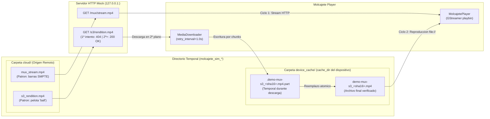
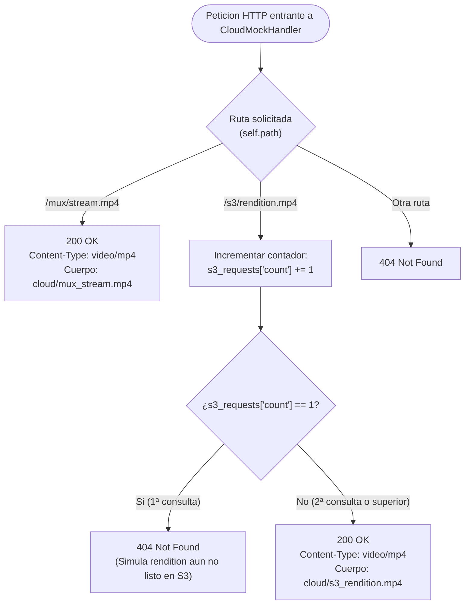

# Servidor de Prueba y Entorno de Simulacion (`simulate_mux_s3_switch.py`)

Este documento detalla el funcionamiento interno del servidor HTTP de prueba y del entorno de simulacion incluidos en [`examples/simulate_mux_s3_switch.py`](../examples/simulate_mux_s3_switch.py). Su objetivo es permitir probar y demostrar en local —sin conexion a Internet ni cuentas en Mux o AWS S3— todo el ciclo de streaming inicial, reintento ante latencia de transcodificacion, descarga en segundo plano y conmutacion a disco local.

---

## 1. Arquitectura General del Simulador

El script levanta en un unico proceso de Python:
1. Un **generador de video sintetico** mediante `gst-launch-1.0` (`videotestsrc` + `x264enc` + `mp4mux`).
2. Un **servidor HTTP multihilo local** (`http.server.ThreadingHTTPServer`) escuchando en `127.0.0.1` en un puerto efimero asignado por el sistema operativo (`port = 0`).
3. Una instancia real de **`MolcajetePlayer`** y **`MediaDownloader`** apuntando a las rutas locales del servidor HTTP y a un directorio temporal que actua como disco del dispositivo.



---

## 2. Estructura de Directorios y Archivos Temporales

Al iniciar `run_simulation()`, se crea un directorio temporal aislado (`tempfile.TemporaryDirectory(prefix="molcajete_sim_")`) que se limpia automaticamente al finalizar la ejecucion. Dentro de el se crean dos subdirectorios que separan el "mundo cloud" del "disco del reproductor":

| Ruta Relativa en TempDir | Rol en la Simulacion | Descripcion |
| :--- | :--- | :--- |
| `cloud/mux_stream.mp4` | Stream de Mux | Video MP4 de ~3 segundos (90 buffers a 30 fps, `640x360`) generado con `pattern=smpte` (barras de color de television). |
| `cloud/s3_rendition.mp4` | Rendition en S3 | Video MP4 de ~3 segundos (90 buffers a 30 fps, `640x360`) generado con `pattern=ball` (pelota en movimiento sobre fondo negro). |
| `device_cache/.demo-mux-s3_<sha16>.mp4.part` | Descarga en curso | Archivo temporal oculto creado por `MediaDownloader` mientras descarga los bloques desde `/s3/rendition.mp4` y calcula su SHA-256. |
| `device_cache/demo-mux-s3_<sha16>.mp4` | `cache_path` (asignado) | Ruta determinista dentro de `cache_dir`. `<sha16>` son los 16 primeros caracteres del `sha256` del rendition. `MediaDownloader.prepare()` la asigna a `item.cache_path`; cuando existe, `MolcajetePlayer` reproduce desde `file://`. |

> **Por que dos patrones visuales distintos**: Al ejecutar el simulador con ventana grafica (`--sink auto` o `--sink gtk`), el cambio visual de **barras de colores (`smpte`)** en la primera vuelta a **la pelota moviendose (`ball`)** en la segunda vuelta demuestra de forma evidente que el reproductor ha dejado de consumir el stream de Mux y ha pasado a reproducir el archivo descargado desde S3.

---

## 3. Rutas (Endpoints) del Servidor HTTP de Prueba

El manejador [`CloudMockHandler`](../examples/simulate_mux_s3_switch.py#L90-L118) implementa las siguientes rutas HTTP sobre `http://127.0.0.1:<puerto>`:

### 3.1 `GET /mux/stream.mp4`
- **Que simula**: La URL de streaming (`remote_url`) proporcionada por Mux nada mas ingerir el video.
- **Comportamiento**:
  - Esta disponible inmediatamente desde el inicio de la simulacion.
  - Lee los bytes de `cloud/mux_stream.mp4` y responde siempre con:
    - Estado: `200 OK`
    - Cabeceras: `Content-Type: video/mp4`, `Content-Length: <tamano>`
- **Quien la consume**: `GStreamer (playbin)` durante el **Ciclo 1**, ya que el rendition aun no existe en `device_cache/`.

### 3.2 `GET /s3/rendition.mp4`
- **Que simula**: La URL del bucket de Amazon S3 (`s3_url`) donde el servicio de transcodificacion deposita el MP4 definitivo.
- **Comportamiento con estado (`s3_requests["count"]`)**:
  - **Primera peticion (`count == 1`)**:
    - Devuelve **`404 Not Found`** sin cuerpo.
    - Simula el lapso de tiempo real en el que Mux ya sirve el stream HLS pero aun no ha terminado de generar y subir el *rendition* MP4 al bucket de S3.
  - **Segunda peticion y posteriores (`count >= 2`)**:
    - Devuelve **`200 OK`** (`Content-Type: video/mp4`, `Content-Length: <tamano>`) con los bytes de `cloud/s3_rendition.mp4`.
    - Simula que el *rendition* ya esta disponible en S3.
- **Quien la consume**: El hilo en segundo plano de `MediaDownloader` (`s3-downloader-demo-mux-s3`).

### 3.3 Cualquier otra ruta (`GET /*`)
- Devuelve **`404 Not Found`**.



---

## 4. Configuracion e Instrumentacion de la Prueba

En la simulacion se instancia un `Playlist` con `loop=True` y un unico `MediaItem`:

```python
item = MediaItem(
    id="demo-mux-s3",
    title="Video Usuario (Mux Stream -> S3 Disco Seguro)",
    remote_url=f"http://127.0.0.1:{port}/mux/stream.mp4",
    s3_url=(
        f"http://127.0.0.1:{port}/s3/rendition.mp4"
        "?X-Amz-Algorithm=AWS4-HMAC-SHA256&X-Amz-Signature=sim-secret-sig"
    ),
    sha256=s3_sha256,  # SHA-256 real de cloud/s3_rendition.mp4
)
```

- `s3_url` imita una **S3 Presigned URL**: los parametros de firma se ocultan en los logs (`?<redacted>`) y no influyen en el nombre del archivo de cache.
- Se usa `http://` porque `validate_download_url()` permite HTTP plano solo hacia loopback (`127.0.0.1`, `localhost`, `::1`).
- No se define `local_path`: el descargador asigna `cache_path` dentro de `cache_dir`.

Y se configura `MediaDownloader(cache_dir=client_dir, retry_interval=1.0, max_retries=10)` para que el reintento tras el primer `404` ocurra 1 segundo despues (antes de que terminen los ~3 segundos de reproduccion del Ciclo 1).

### Verificacion Automatica por Ciclos
El script registra cada elemento que empieza a mostrarse mediante el callback `on_item_start` de `MolcajetePlayer` (se invoca tanto en el primer `play_item_at_index` como en cada cambio sin huecos) y guarda la URI en `uris_played`:
1. **Ciclo 1**: `uris_played[0]` es `http://127.0.0.1:<port>/mux/stream.mp4`. En paralelo, `MediaDownloader` recibe `404` en el intento 1, espera `1.0s`, recibe `200 OK` en el intento 2, verifica el SHA-256 y guarda `device_cache/demo-mux-s3_<sha16>.mp4`.
2. **Precarga**: unos segundos antes del final del ciclo, `playbin` emite `about-to-finish` y el reproductor elige la URI de la vuelta siguiente. Si el rendition ya esta verificado, precarga `file://`; si no, vuelve a precargar el stream y el cambio a disco ocurre en una vuelta posterior.
3. **Fin**: en cuanto empieza un ciclo con `file://` (o tras `MAX_CYCLES = 5` ciclos), el callback programa `player.stop()`. La simulacion devuelve `0` (`EXITO`) si `uris_played[0]` empieza por `http://` y alguna URI posterior por `file://`; si no, `1` (`FALLO`).

---

## 5. Ejecucion y Salida Esperada

### Ejecucion con ventana grafica
```bash
PYTHONPATH=src python3 examples/simulate_mux_s3_switch.py --sink auto
```

### Ejecucion sin entorno grafico (headless)
```bash
PYTHONPATH=src python3 examples/simulate_mux_s3_switch.py --sink fakesink
```

### Trazas esperadas en consola
```text
INFO simulation: Generating test videos with GStreamer (~3s each)...
INFO molcajete_player.player: Playing item [1/1] 'Video Usuario (Mux Stream -> S3 Disco Seguro)' (demo-mux-s3) -> URI: http://127.0.0.1:xxxxx/mux/stream.mp4
INFO simulation: >>> [CYCLE 1] Source selected: http://127.0.0.1:xxxxx/mux/stream.mp4
INFO molcajete_player.downloader: Downloading rendition for 'demo-mux-s3' (attempt 1/10): http://127.0.0.1:xxxxx/s3/rendition.mp4?<redacted>
INFO molcajete_player.downloader: Rendition for 'demo-mux-s3' not available yet (HTTP 404). Retrying in 1.0s...
INFO molcajete_player.downloader: Downloading rendition for 'demo-mux-s3' (attempt 2/10): http://127.0.0.1:xxxxx/s3/rendition.mp4?<redacted>
INFO molcajete_player.downloader: Rendition download completed and verified for 'demo-mux-s3' -> /tmp/molcajete_sim_.../device_cache/demo-mux-s3_<sha16>.mp4 (sha256=<sha16>). The file on disk will be used the next time it plays.
INFO molcajete_player.player: Preloading next item 'demo-mux-s3' -> file:///tmp/molcajete_sim_.../device_cache/demo-mux-s3_<sha16>.mp4
INFO molcajete_player.player: Playing item [1/1] 'Video Usuario (Mux Stream -> S3 Disco Seguro)' (demo-mux-s3) -> URI: file:///tmp/molcajete_sim_.../device_cache/demo-mux-s3_<sha16>.mp4
INFO simulation: >>> [CYCLE 2] Source selected: file:///tmp/molcajete_sim_.../device_cache/demo-mux-s3_<sha16>.mp4
INFO simulation: Simulation finished. Stopping...
INFO simulacion: Resumen de URIs reproducidas por orden: [...]
INFO simulacion: EXITO: Se inicio reproduciendo el stream y se conmuto al archivo en disco tras descargar de S3.
```

